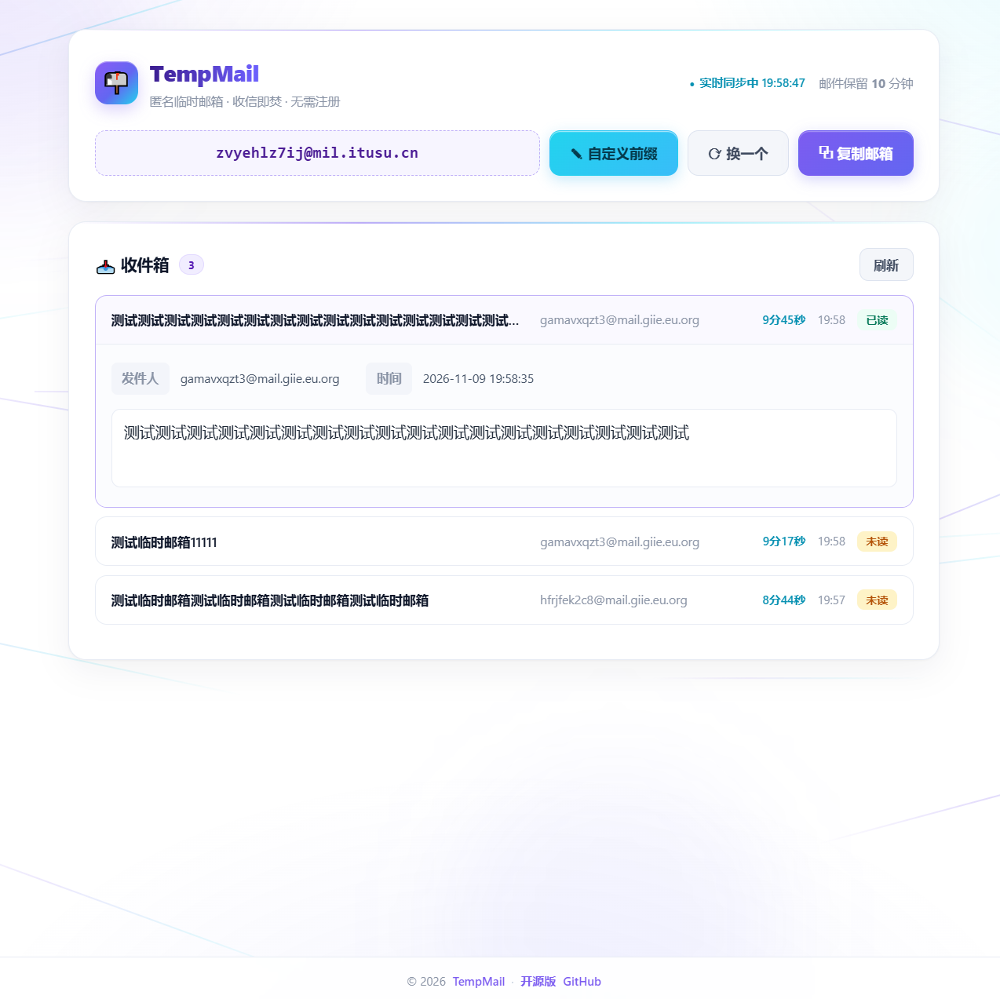
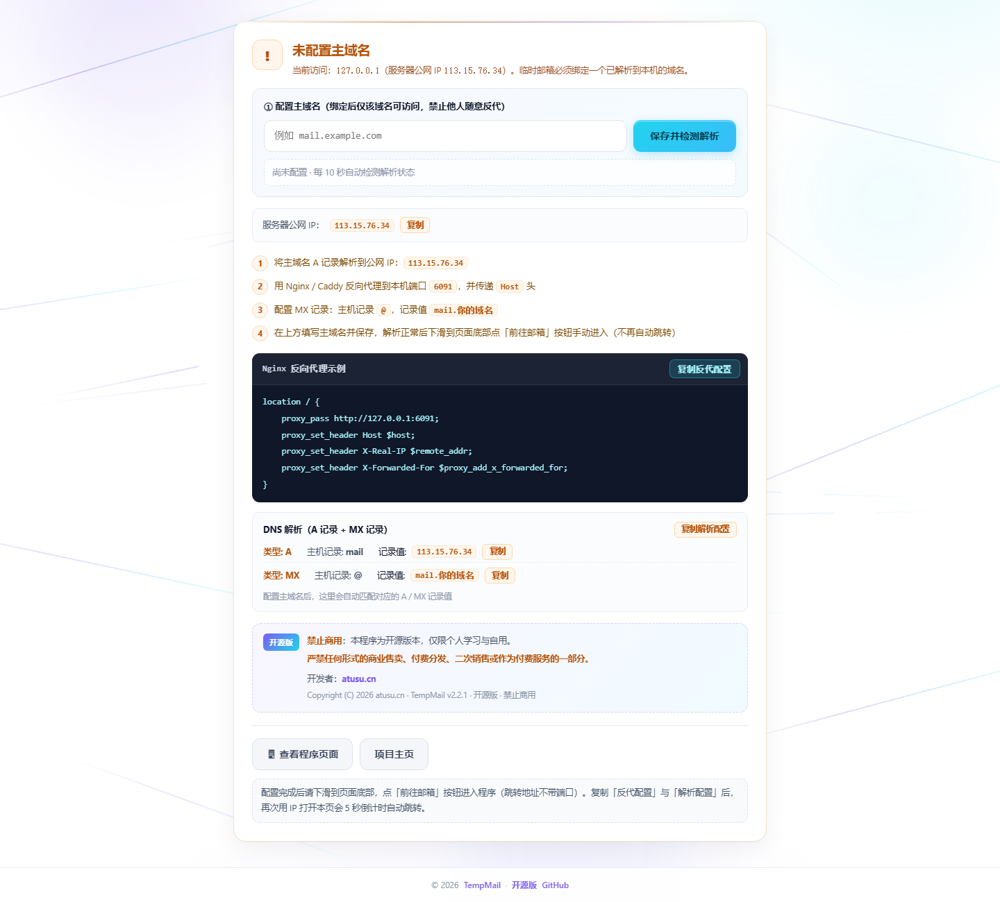

# TempMail · 自建临时邮箱

> **开源版 · 禁止商用** ｜ 开发者 [atusu.cn](https://atusu.cn/mail) ｜ 项目主页 [atusu.cn/mail](https://atusu.cn/mail)
> 版本 **2.3.0** ｜ Linux（x86_64 / ARM64 / ARMv7）· macOS（Intel / Apple Silicon）· Docker

轻量、可自托管的临时邮箱（Temp Mail）系统：网页一键生成一次性邮箱，内置 SMTP 直接收信，
附件在线预览，无需注册、无需外部数据库（SQLite），**一个程序文件即可运行**。




---

## 一、特性一览

| 能力 | 说明 |
| --- | --- |
| 临时邮箱 | 随机生成 / 自定义前缀 / 一键复制，有效期 24 小时可配置 |
| 实时收信 | 内置 SMTP（默认 25 端口）直收，前端 5 秒增量同步 |
| 邮件阅读 | HTML 正文 iframe 沙箱渲染、纯文本排版、已读未读、附件下载、图片灯箱 |
| 主域名绑定 | 必须绑定一个已解析到本机的域名，**其它域名反代一律 403**，防止被随手拿去用 |
| 检测引导页 | 用 IP 打开时展示反代与 A / MX 记录，按填写的域名自动推导记录值并带复制按钮 |
| 一键复制 | 检测页的反代 / 解析配置、介绍页的 Nginx 示例均带复制按钮，不用手抄 |
| 跳转策略 | 首次配置**不自动跳转**；复制过两项配置后再访问才 5 秒倒计时，点「查看检测页面」可停止 |
| 静默回传 | 每次部署与每次域名配置后台回传（IP / 部署时间 / 域名 / 指纹），失败每 10 分钟重试 |
| 端口自适应 | 部署时检测 Web 端口：自家旧实例先停止复用，其它程序占用自动顺延并写回 `.env` |
| 25 端口治理 | 部署时检测并释放被 postfix / exim4 等占用的 25 端口 |
| 一键部署 | `install.sh` 直接装成 systemd 服务，`docker.sh` 一条命令起容器 |
| 在线部署 | `install-remote.sh` 一条命令自动下载对应架构程序；内置多个下载站，主站不可用自动切换 |
| 服务管理 | 重装 / 清理重装 / 启动 / 停止 / 重启 / 重载 / 卸载 / 清配置 / 状态 |

---

## 二、目录结构

两种安装包，**每种包都自带 `install.sh` 与 `docker.sh` 两个脚本**，按需二选一。

```

├── screenshots/                # 介绍页与配置页截图（README 引用）
├── README.md                   # 本文件
├── LICENSE                     # 非商业许可
├── build.sh / build.py         # 打包脚本：只把必要文件打进单文件包
├── binary/                     # 【包一】发布产物（单文件程序 + 部署脚本）
└── source/                     # 【包二】源码包：用 app.py 跑
    ├── app.py                  # 主程序（Flask + aiosmtpd + SQLite，单文件）
    ├── requirements.txt        # Python 依赖
    ├── Dockerfile              # Docker 镜像
    ├── docker-compose.yml      # Docker Compose 编排
    ├── LICENSE
    ├── install.sh              # 直接部署（venv + systemd）
    └── docker.sh               # Docker 部署
```

二进制包：不需要 Python    [多架构包下载](https://github.com/atanzhen/Mail/releases/tag/2.3.0) 

```
└──  binary/  
    ├── TempMail-2.3.0-linux-amd64
    ├── TempMail-2.3.0-linux-arm64
    ├── TempMail-2.3.0-linux-armv7
    ├── TempMail-2.3.0-macos-amd64
    ├── TempMail-2.3.0-macos-arm64
    ├── install.sh              # 直接部署（systemd 守护）
    ├── docker.sh               # Docker 部署
    └── SHA256SUMS              # 校验值
```
> 上传到服务器时**不需要整套上传**。只用二进制包时，`binary/` 里只放
> **与本机架构一致的那一个程序文件** + `install.sh` + `docker.sh` 即可，其余平台的包可以不放。

---

## 三、快速开始

### 3.1 二进制包 + `install.sh`（推荐）

```bash
# 把 3 个文件放到同一个目录（程序文件只放本机架构那一个）
#   TempMail-2.3.0-linux-amd64
#   install.sh
#   docker.sh
chmod +x TempMail-2.3.0-* install.sh docker.sh

sudo bash install.sh             # 首次：自动识别架构 → 装 systemd 服务 → 启动
sudo bash install.sh             # 再次执行：进入管理菜单
```

- 自动识别本机架构（amd64 / arm64 / armv7），**只放一个匹配的程序文件也能正常部署**；
  文件名不用改，即使目录里同时有多个平台的包也会挑出本机可用的那个。
- 架构不匹配会直接报错并提示该上传哪个文件，不会装错。
- **端口被占用会自动处理**：如果是本程序旧实例占用，先停止再复用；如果是其它程序占用，
  自动向后找一个空闲端口，写回 `.env` 并输出实际端口。安装结束请以打印的「访问链接」为准。
- 安装目录 `/opt/temp-mail`，数据在 `/opt/temp-mail/data`，服务名 `temp-mail`，开机自启。
- 部署脚本**不解压**：只把程序复制成 `/opt/temp-mail/tempmail` 一个文件，再由 systemd 直接启动它。
  安装后目录里只有：`tempmail`（单文件程序）/ `data/` / `.env` / `install.sh`。

```bash
# 也可以完全不装服务，直接跑
./TempMail-2.3.0-linux-amd64
APP_PORT=8080 ./TempMail-2.3.0-linux-amd64
```

### 3.2 二进制包 + `docker.sh`

```bash
chmod +x docker.sh
sudo bash docker.sh              # 自动取 Docker 架构 → 选对应 Linux 程序 → 构建镜像 → 启动

sudo bash docker.sh status       # 状态 / 访问地址
sudo bash docker.sh logs -f      # 实时日志
sudo bash docker.sh down         # 停止并删除容器（数据保留）
```

### 3.3 源码包 + `install.sh`

```bash
chmod +x install.sh docker.sh
sudo bash install.sh             # 自动检测 python3 → 建 venv → 装依赖 → systemd 启动
sudo bash install.sh install --mirror https://pypi.tuna.tsinghua.edu.cn/simple   # 国内加速
sudo bash install.sh install --web-port 8080 --smtp-port 25                     # 指定端口
```

- 依赖装在 `/opt/temp-mail/venv` 里，不影响系统 Python；虚拟环境不可用时自动退回系统 pip。
- 数据同样在 `/opt/temp-mail/data`。

### 3.4 源码包 + `docker.sh`

```bash
chmod +x docker.sh
sudo bash docker.sh              # 用 app.py + Dockerfile 构建镜像并启动
sudo bash docker.sh rebuild      # 无缓存重建（改了 app.py 后 up 也会自动重建）
```

### 3.5 在线一键部署 `install-remote.sh`（服务器上不用先放程序）

```bash
curl -fsSL https://atusu.cn/mail/install-remote.sh | sudo bash
```

- 脚本自己 `uname -m` 认架构 → 从发布目录下载 `linux-<架构>` 的程序 → SHA256 校验 → 装成 systemd 服务。
- 换端口 / 指定镜像 / 只用指定源：
  ```bash
  curl -fsSL https://atusu.cn/mail/install-remote.sh | sudo bash -s -- install --web-port 8080
  curl -fsSL https://atusu.cn/mail/install-remote.sh | sudo bash -s -- \
       install --mirrors "https://a.com/mail https://b.com/mail"
  TM_MIRRORS="https://a.com/mail" ... | sudo bash -s -- install --no-fallback
  ```
### 3.6 其它方式

```bash
# Docker Compose（源码目录内，与脚本二选一，不要同时管理同一个容器）
docker compose up -d

# 手动运行（临时调试）
pip install -r requirements.txt
python app.py
```
---

## 五、绑定主域名（必须）

程序只允许**一个主域名**访问，其它域名反代过来返回 403，避免被随意搭建。

1. 用 `http://服务器IP:6060` 打开，进入「未配置主域名」检测页。
2. 在 DNS 服务商处添加记录（检测页会按你填的域名自动推导记录值，并带复制按钮）：

   | 类型 | 主机记录 | 记录值 | 说明 |
   | --- | --- | --- | --- |
   | A | `mail` | `服务器公网 IP` | 三级域名时主机记录取首段 |
   | MX | `@` | `mail.example.com` | 收信指向该域名，优先级 10 |

3. Nginx / Caddy 反向代理到本机端口（示例，检测页可一键复制）：

   ```nginx
   location / {
       proxy_pass http://127.0.0.1:6060;
       proxy_set_header Host $host;
       proxy_set_header X-Real-IP $remote_addr;
       proxy_set_header X-Forwarded-For $proxy_add_x_forwarded_for;
   }
   ```

   > `Host` 头必须透传，程序靠它判断访问域名是否已授权。

4. 回到检测页填写主域名 → 「保存并检测解析」。解析正常后**下滑到页面底部**，
   点「前往邮箱」按钮手动进入（跳转地址**不带端口**，一律走域名）。

**跳转规则**

- 首次保存配置：只显示引导与「前往邮箱」按钮，**不自动跳转**，方便看清解析与反代配置。
- 已复制「反代配置」和「解析配置」后再次用 IP 打开本页：5 秒倒计时自动前往域名页面。
- 倒计时期间点「查看检测页面」即停止跳转，转为手动点击进入。

---

## 六、配置项（环境变量 / `.env`）

安装后配置文件在 `/opt/temp-mail/.env`（Docker 方式为脚本生成的 `.env.docker`）。

| 变量 | 默认 | 说明 |
| --- | --- | --- |
| `APP_PORT` | `6060` | Web 端口（部署脚本检测占用：自家实例复用，其它程序占用自动顺延并写回） |
| `SMTP_PORT` | `25` | 收信端口 |
| `DB_FILE` | `./temp_mail.db` | SQLite 路径 |
| `CONFIG_FILE` | `./config.json` | 主域名配置文件 |
| `PRIMARY_DOMAIN` | 空 | 指定主域名（优先级高于 config.json） |
| `FRONT_RETENTION_MINUTES` | `10` | 前端保留时长 |
| `BACKEND_RETENTION_DAYS` | `7` | 数据库清理周期 |
| `MAILBOX_VALIDITY_HOURS` | `24` | 邮箱有效期 |
| `PUBLIC_IP` | 自动 | 手动指定公网 IP（内网 / 探测失败时使用） |
| `DEPLOY_REPORT_URL` | `http://ac.atusu.cn/mail.php` | 部署回传地址，留空即关闭 |
| `DEPLOY_REPORT_RETRY` | `600` | 回传失败重试间隔（秒） |

---

## 七、常用命令与排错

```bash
systemctl status temp-mail          # 服务状态
sudo bash /opt/temp-mail/install.sh # 管理菜单
journalctl -u temp-mail -f          # 实时日志
nano /opt/temp-mail/.env            # 端口 / PUBLIC_IP 等配置

cd binary && sha256sum -c SHA256SUMS   # 校验二进制完整性
```

**Q：`./install.sh` 或 `./docker.sh` 报 `: No such file or directory`？**
脚本在传输过程中被转成了 CRLF 换行（Windows 编辑器常见）。执行一次即可修复：

```bash
sed -i 's/\r$//' install.sh docker.sh
# 或者干脆用 bash 显式调用
bash install.sh
```

**Q：访问域名显示 403？**
该域名不是已绑定的主域名，或 DNS 未解析到本机。用 IP 打开检测页确认主域名与解析状态。

**Q：检测页一直提示等待解析？**
DNS 生效通常需要几分钟到几小时；确认 A 记录指向的是**公网 IP**（内网部署会退回校验网卡 IP），
并确认反代透传了 `Host` 头。页面每 10 秒自动复检。

**Q：为什么点击保存后没有自动跳转？**
有意设计：首次配置不跳转，避免直接跳走看不到解析与反代配置。**下滑到页面底部**点「前往邮箱」按钮即可进入。

**Q：6060 端口被其它程序占用了怎么办？**
不用手动改。`install.sh` 会先判断占用方：自家旧实例会先停止再复用原端口；
其它程序占用则自动顺延到一个空闲端口，并写回 `.env`。部署结束会打印实际访问端口，
配置页里的「反代配置」也会显示当前真实端口，按它填 Nginx 即可。

**Q：收不到邮件？**
确认 25 端口放通（云厂商安全组 + 主机防火墙），并确认 MX 记录指向的域名有 A 记录。

**Q：能商用吗？**
不能。本程序为开源版本，仅限个人学习与自用，严禁商业售卖、付费分发、二次销售或作为付费服务的一部分。

---

## 九、许可

```
Copyright (C) 2026 atusu.cn
开源版 · 禁止商用（Non-commercial use only）
详见 LICENSE 文件。
```

开发者：[atusu.cn](https://atusu.cn/mail) ｜ 项目仓库：[github.com/atanzhen/Mail](https://github.com/atanzhen/Mail)
